# Awesome Generative 3D Modeling & AI Asset Pipelines 🎨⚡

  

  
  
  
  
  

---

## 🌟 Overview & SEO Meta Summary

> **Keywords:** *Generative 3D AI, Text-to-3D, Image-to-3D Foundation Models, 3D Mesh Generation, PBR Texture Synthesis, Quad Retopology, Skeletal Auto-Rigging, 3D Gaussian Splatting, NeRF, Game-Ready Asset Pipelines, TRELLIS, Hunyuan3D-2, TripoSR, PyTorch3D, Open3D, Blender AI Workflows.*

A comprehensive, curated repository and industry directory of **Generative 3D Modeling & AI Asset Pipelines**. Whether you are building real-time AAA/indie games in Unreal Engine or Unity, designing spatial computing experiences for visionOS and WebXR, or training robotic digital twins, this collection catalogs the premier **commercial SaaS platforms** and **open-source foundation models** for high-fidelity 3D mesh synthesis, automated PBR material generation, neural UV unwrapping, and skeletal auto-rigging.

---

## 📑 Table of Contents

- [📊 Sector Overview & Market Dynamics](#-sector-overview--market-dynamics)
- [☁️ SaaS / Hosted & Commercial Platforms](#️-saas--hosted--commercial-platforms)
- [💻 Open-Source GitHub Projects](#-open-source-github-projects)
- [⭐ Star History](#-star-history)
- [🛠️ How to Contribute](#️-how-to-contribute)
- [💖 Support & Thank You](#-support--thank-you)
- [⚠️ Disclaimer](#️-disclaimer)

---

## 📊 Sector Overview & Market Dynamics

The global generative 3D modeling and AI asset creation market is valued at approximately **$4.8B–$6.5B in 2026**, growing at a ~28%–35% CAGR driven by AAA/indie game studios, spatial computing/XR headsets, VFX production, and automated 3D digital twins. The sector is currently **moderately fragmented**—top frontier model developers and multimodal labs compete across specialized niches (rapid prototyping, quad-topology game meshes, CAD/parametric props, and avatar rigging), while facing intense downward margin pressure from rapidly maturing open-weight foundation models and local inference pipelines.

---

## ☁️ SaaS / Hosted & Commercial Platforms

*Sorted descending by company valuation / scale.*

| Platform | Description | Company Scale (Valuation / Revenue) | Starting Paid Tier | Free Tier / Trial Limit |
| :--- | :--- | :--- | :--- | :--- |
| **[Luma AI (Luma Genie)](https://lumalabs.ai)** 🪄 | Multimodal 3D capture and generative 3D asset pipeline converting text prompts, images, and videos into PBR-textured meshes and NeRF/3DGS scenes. | **~$300M–$500M+ Valuation** ($70M+ VC funding led by a16z) | **$9.99 / month** ($7.99/mo billed annually for Lite plan; $29.99/mo Plus plan with 10,000 credits/mo) | **Forever Free Plan** (Daily non-commercial test generation quota with watermarks; unlimited capture viewing) |
| **[Meshy.ai](https://meshy.ai)** 🎮 | Flagship AI 3D modeling and PBR texturing suite generating game-ready, quad-retopologized, UV-unwrapped, and auto-rigged 3D assets from text or images. | **~$100M–$200M Est. Valuation** (~$15M–$25M+ est. ARR; >2M 3D creators) | **$16 / month** billed annually ($20/mo monthly for Pro plan with 1,000 credits/mo) | **Forever Free Plan** (**200 free generation credits/month**, max 10 tasks/day, CC-BY-4.0 non-commercial license) |
| **[Tripo 3D (VAST AI)](https://tripo3d.ai)** ⚡ | Ultra-fast 3D foundation model SaaS and REST API generating clean quad-retopologized, rigged, and PBR-textured 3D models in seconds. | **~$100M+ Est. Valuation** ($30M+ VC funding; creators of open-source TripoSR) | **$15.90 / month** billed annually ($19.90/mo monthly for Professional plan with 3,000 credits/mo) | **Forever Free Basic Plan** (**300 free credits/month** (~10–30 generations/mo), standard queue, personal use license) |
| **[Spline AI](https://spline.design)** 🌐 | Collaborative browser-based 3D design studio with native AI text-to-3D generation, AI style transfer, and direct React/Three.js/visionOS exports. | **~$50M–$100M Est. Valuation** ($15M+ VC funding led by Gradient & First Round) | **$12 / month** billed annually ($15/mo monthly for Starter; $20/mo monthly for Pro with AI generation) | **Forever Free Basic Plan** (**Unlimited personal 3D files**, interactive web embeds, 1 shared folder; Spline watermark on exports) |
| **[Rodin Gen-1 / Gen-2 (Deemos / Hyper3D)](https://hyper3d.ai)** 🗿 | High-precision generative 3D asset platform producing part-aware geometry and studio-grade PBR textures from multi-view images and text prompts. | **~$50M–$100M Est. Valuation** (Venture-backed spatial AI foundation lab) | **$24 / month** billed annually ($30/mo monthly for Creator plan with ~60 model generations) | **Forever Free Plan** (Free medium-quality generation previews, 10 private asset storage slots, public gallery sharing) |
| **[Kaedim](https://kaedim3d.com)** 🎨 | Hybrid AI + artist-in-the-loop 3D production pipeline converting 2D concept art into studio-grade, clean-topology, UV-unwrapped game assets. | **~$50M–$80M Est. Valuation** ($15M+ Series A led by a16z) | **$29 / month** for Indie tier ($150/mo for Starter with 10 production assets/mo) | **7-Day Paid Evaluation Trial** ($50 for 7 days testing trial, renews into monthly subscription unless canceled) |
| **[CSM 3D (Common Sense Machines)](https://csm.ai)** 📦 | Multimodal 3D asset and world generation platform turning images, sketches, and video clips into controllable, game-ready 3D meshes. | **~$40M–$70M Est. Valuation** ($15M+ VC funding led by a16z) | **$15 / month** billed annually ($20/mo monthly for Maker plan) | **Forever Free Explorer Plan** (Limited complimentary image-to-3D monthly generation credits and public gallery preview access) |
| **[Masterpiece X](https://masterpiecex.com)** 🤖 | Browser-based text-to-3D generative studio engineered for game developers and XR creators, outputting textured, auto-rigged, and animated FBX/GLB models. | **~$15M–$30M Est. Valuation** (~$10M+ VC funding; Canadian spatial AI company) | **$10.99 / month** for Starter tier (750 credits/month; $19.99/mo for 1,500 credits) | **Forever Free Tier** (**250 free starter credits** upon registration to generate textured/rigged 3D models) |
| **[Sloyd.ai](https://sloyd.ai)** 🏗️ | Parametric + AI 3D asset generator and game-engine SDK creating customizable, clean-topology, UV-mapped props and buildings in real time. | **~$10M–$25M Est. Valuation** (Venture-backed Norwegian 3D tech startup) | **$15 / month** billed annually ($20/mo monthly for Plus plan with 50 advanced credits) | **Forever Free Guest Plan** (**1 free AI 3D generation per day**, unlimited real-time parametric editor tweaks, personal use license) |
| **[3DFY.ai](https://3dfy.ai)** 🛍️ | Automated prompt-to-3D and scalable catalog generation platform synthesizing clean, segmented, UV-mapped 3D models for games and e-commerce. | **~$10M–$20M Est. Valuation** (Venture-backed Israeli generative 3D company) | **$5.00 / download** (pay-as-you-go; subscription packs starting at $110/mo for 40 downloads & 400 generations) | **Free Evaluation Trial** (**10 free generation credits** upon sign-up to test prompt-to-3D previews) |

---

## 💻 Open-Source GitHub Projects

*Sorted descending by GitHub repository Stars_Counts. Stars_Badges link directly to each repository's stargazers page.*

| Project | GitHub_Stars | License / Hosting | Free Tier / Self-Hosted Limit | Description |
| :--- | :---: | :--- | :--- | :--- |
| **[3D Gaussian Splatting](https://github.com/graphdeco-inria/gaussian-splatting)**  🌟 | ~24.5k+ | **Inria Non-Commercial Research** | **100% Free self-hosted** | Breakthrough real-time radiance field rendering algorithm delivering photorealistic 3D scene reconstruction and real-time GPU rasterization from multi-view images. |
| **[Tencent Hunyuan3D-2](https://github.com/Tencent/Hunyuan3D-2)**  🚀 | ~15.5k+ | **Tencent Open-Source / Apache-2.0** | **100% Free self-hosted** | Next-generation high-resolution 3D foundation model supporting fast single-image-to-3D and text-to-3D generation with structured shape modeling and high-fidelity textures. |
| **[Microsoft TRELLIS](https://github.com/microsoft/TRELLIS)**  ⚡ | ~14.4k+ | **MIT License** | **100% Free self-hosted** | Large multimodal 3D foundation model generating textured 3D meshes, radiance fields, and 3D Gaussian Splats from a single image in seconds with precise geometry. |
| **[Open3D](https://github.com/isl-org/Open3D)**  📚 | ~14.2k+ | **MIT License** | **100% Free self-hosted** | Modern open-source library for 3D data processing, point cloud alignment, mesh manipulation, neural surface reconstruction, and visualization in C++ and Python. |
| **[nerfstudio](https://github.com/nerfstudio-project/nerfstudio)**  🎥 | ~12.2k+ | **Apache-2.0 License** | **100% Free self-hosted** | Modular PyTorch framework for neural radiance field (NeRF) and Gaussian splatting development, real-time web visualizer, export pipelines, and camera path rendering. |
| **[PyTorch3D](https://github.com/facebookresearch/pytorch3d)**  🔬 | ~10.0k+ | **BSD-3-Clause** | **100% Free self-hosted** | Meta FAIR's optimized library providing differentiable 3D geometric operations, mesh renderers, point cloud operators, and neural loss functions for deep learning. |
| **[stable-dreamfusion](https://github.com/ashawkey/stable-dreamfusion)**  🌈 | ~8.8k+ | **Apache-2.0 License** | **100% Free self-hosted** | PyTorch implementation of text-to-3D and image-to-3D synthesis using 2D Stable Diffusion priors with NeRF rendering and DMTet mesh extraction. |
| **[TripoSR](https://github.com/VAST-AI-Research/TripoSR)**  🏎️ | ~7.4k+ | **MIT License** | **100% Free self-hosted** | Fast 3D feedforward reconstruction model by VAST AI and Stability AI generating textured 3D meshes from a single 2D image in under 0.5 seconds on local GPUs. |
| **[threestudio](https://github.com/threestudio-project/threestudio)**  🛠️ | ~7.0k+ | **Apache-2.0 License** | **100% Free self-hosted** | Unified modular framework for 3D content creation from text, image, and multi-view inputs supporting Score Distillation Sampling (SDS) and modern 3D representations. |
| **[Instant Meshes](https://github.com/wjakob/instant-meshes)**  📐 | ~6.3k+ | **BSD-3-Clause** | **100% Free self-hosted** | Industry-standard interactive field-aligned quad and triangle mesh retopology tool that converts high-poly raw AI scans into production game geometry. |
| **[InstantMesh](https://github.com/TencentARC/InstantMesh)**  ⏱️ | ~4.6k+ | **Apache-2.0 License** | **100% Free self-hosted** | Tencent ARC's feedforward framework for efficient 3D mesh generation from a single image in 10 seconds with clean topology and standard texture maps. |
| **[ComfyUI-3D-Pack](https://github.com/MrForExample/ComfyUI-3D-Pack)**  🧩 | ~3.9k+ | **GPL-3.0 License** | **100% Free self-hosted** | Comprehensive suite of custom ComfyUI nodes bringing 3D mesh reconstruction, Gaussian Splatting, NeRF, texture projection, and 3D previewers into local node graphs. |
| **[Unique3D](https://github.com/AiuniAI/Unique3D)**  💎 | ~3.6k+ | **GPL-3.0 License** | **100% Free self-hosted** | High-fidelity image-to-3D generation system that leverages multi-view diffusion and normal-guided mesh refinement for detailed characters and objects. |
| **[xatlas](https://github.com/jpcy/xatlas)**  🗺️ | ~2.6k+ | **MIT License** | **100% Free self-hosted** | Lightweight C/C++ and Python mesh unwrapping and UV parameterization library essential for baking generative AI textures onto complex 3D meshes without overlap. |
| **[QuadriFlow](https://github.com/hjwdzh/QuadriFlow)**  🔲 | ~880+ | **MIT License** | **100% Free self-hosted** | Scalable and robust quadrangulation algorithm for converting triangular meshes and point clouds into clean, manifold quad meshes with minimal singularity count. |
| **[Paint3D](https://github.com/OpenTexture/Paint3D)**  🖌️ | ~815+ | **Apache-2.0 License** | **100% Free self-hosted** | Coarse-to-fine texture synthesis model painting high-resolution 2K/4K UV texture maps on arbitrary untextured 3D meshes using depth-aware diffusion. |
| **[3D New Era AI (`leandrodaf/3d-new-era-ai`)](https://github.com/leandrodaf/3d-new-era-ai)**  🌐 | ~266+ | **Open-Source** | **100% Free self-hosted** | Open-source generative 3D modeling and AI asset pipeline repository modernizing local 3D creation and spatial asset processing workflows. |

---

## 📈 Star History

---

## 🛠️ How to Contribute

Contributions are warmly encouraged! Help keep this directory current, accurate, and useful for the entire 3D technical art & spatial computing community:

1. **Fork the repo** to your GitHub account 🍴
2. **Create a descriptive branch**: `git checkout -b feature/add-new-tool` 🌿
3. **Add your tool or library** under the appropriate SaaS or Open-Source section 📝
   - SaaS entries must include factual pricing and specific free tier/trial limits.
   - Open-source entries must include license, links, description, and Stars_Badge.
4. **Commit your changes**: `git commit -m "feat: add [Tool Name]"` 💬
5. **Push and open a Pull Request**: Submit your PR for review 🚀

---

## 💖 Support & Thank You

A huge thank you to all the 3D developers, technical artists, and open-source researchers driving spatial computing forward! 

If this curated repository helps your workflow, projects, or studio pipeline, please consider:
- ⭐ **Starring** the repository on GitHub
- 🍴 **Forking** it to experiment with your own asset pipelines
- 📢 **Sharing** it with friends, game dev colleagues, and spatial computing communities
- ☕ **Supporting ongoing curation & maintenance** by buying a coffee via the [GitHub Sponsor Dashboard](https://github.com/sponsors/ishandutta2007)!

  

---

## ⚠️ Disclaimer

Product names, logos, brands, and registered trademarks featured or referenced within this repository are the property of their respective trademark holders. Mention of commercial products or open-source software does not imply formal endorsement. All pricing tiers, credit allocations, and feature sets are subject to change by their respective providers.
